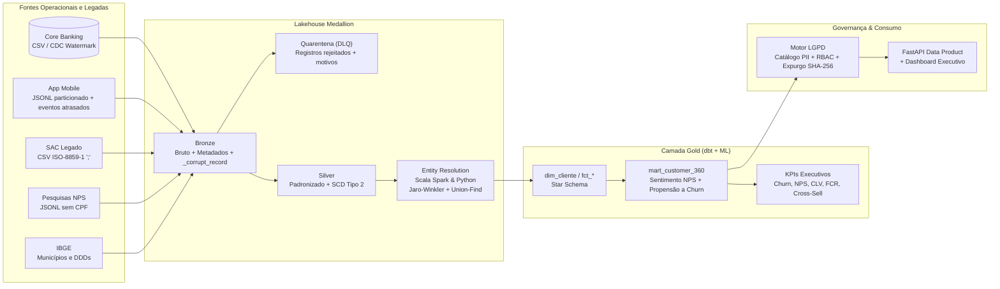

# NovaBank Customer 360 Lakehouse & Governance Platform

Plataforma ponta a ponta de **Engenharia de Dados, Governança (LGPD), Entity Resolution e Machine Learning** construída para o banco digital fictício **NovaBank**.

O projeto resolve um problema central de grandes instituições financeiras: **unificar cadastros fragmentados e inconsistentes de 5 sistemas distintos** em um **Golden Record (Visão 360 do Cliente)** auditável, com histórico **SCD Tipo 2**, **Direito ao Esquecimento automatizado (Art. 18 da LGPD)** e **modelo preditivo de Churn**.

---

## Arquitetura Medallion (Bronze -> Silver -> Gold)



---

## Destaques Técnicos

| Frente | Implementação no Projeto |
|---|---|
| **Ingestão Multi-Fonte & Watermark** | Carga incremental por watermark (`updated_at`, `data_hora`), detecção automática de encoding (`UTF-8` vs `ISO-8859-1` / `latin-1`) e captura de JSON truncado em `_corrupt_record` (`src/customer360/ingestion/bronze.py`). |
| **Qualidade de Dados & Quarentena** | Motor declarativo de expectativas (`src/customer360/quality/expectations.py`) que valida CPFs pelo dígito verificador módulo 11, domínios e faixas numéricas, isolando falhas críticas em `quarantine/` sem descartar dados em silêncio. |
| **Padronização & SCD Tipo 2** | Normalização de 6 formatos de datas legadas, recuperação de zeros à esquerda em CPFs e construção de histórico **Slowly Changing Dimension Tipo 2** (`effective_from`, `effective_to`, `is_current`, `version_num`) em Python e PySpark (`spark_jobs/bronze_to_silver_spark.py`). |
| **Entity Resolution (Scala Spark + Python)** | Algoritmo de *Multi-Pass Blocking* + similaridade **Jaro-Winkler** e **Levenshtein** + *Union-Find* com restrição *Cannot-Link* por CPF distinto. Avaliado contra o gabarito (*Ground Truth*) com **BCubed F1-Score > 90%** (`scala/entity-resolution/` e `src/customer360/entity_resolution/matcher.py`). |
| **Governança & Motor LGPD** | Scanner automático de PII, pseudonimização criptográfica **HMAC-SHA256**, mascaramento dinâmico por perfil (**RBAC**: `ANALISTA`, `ATENDENTE`, `DPO`) e pipeline de **Direito ao Esquecimento** que expurga/anonimiza em Bronze, Silver e Gold emitindo certificado assinado com SHA-256 (`src/customer360/governance/lgpd.py`). |
| **SQL / dbt & KPIs Executivos** | Modelos dimensionais no `dbt_customer360/`, análise de sentimento em português sobre comentários livres do NPS, modelo de propensão a **Churn** com explicabilidade (XAI) e KPIs corporativos (NPS, Churn, CLV, TPV, FCR, TMA e Cross-Sell). |
| **Orquestração Airflow** | DAGs prontas em `airflow/dags/` para o pipeline diário Medallion (com verificação de SLA e alerta de F1-Score) e para expurgo LGPD sob demanda. |

---

## Como Executar Localmente

### 1. Instalar e rodar a suíte de testes E2E
```bash
pip install -e ".[dev]" fastapi uvicorn httpx
PYTHONPATH=src pytest -v
```

### 2. Gerar dados sintéticos e executar o pipeline completo
```python
from customer360.pipeline import run_full_pipeline

resumo = run_full_pipeline("data", n_customers=500, months=3, seed=42)
print(resumo)
```

### 3. Subir a API FastAPI e o Dashboard Executivo
```bash
PYTHONPATH=src uvicorn customer360.api.app:app --reload --port 8000
```
- **Dashboard Executivo**: `http://localhost:8000/dashboard`
- **Documentação Interativa (Swagger)**: `http://localhost:8000/docs`
- **Perfil 360 com Mascaramento RBAC**: `GET /api/v1/customers/M0000001/360?role=ANALISTA` vs `?role=DPO`
- **Direito ao Esquecimento (LGPD)**: `POST /api/v1/governance/lgpd/forget`

---

## Estrutura do Repositório

```text
novabank-customer360/
├── ci/github-actions-ci.yml                # Pipeline CI (pytest E2E)
├── airflow/dags/
│   ├── dag_customer360_medallion.py        # DAG diária Bronze -> Silver -> ER -> Gold -> LGPD
│   └── dag_lgpd_erasure.py                 # DAG de Direito ao Esquecimento (Art. 18 LGPD)
├── dbt_customer360/
│   ├── dbt_project.yml
│   └── models/
│       ├── marts/mart_customer_360.sql     # Modelo SQL dimensional do Customer 360
│       └── schema.yml                      # Contratos e testes de qualidade dbt
├── scala/entity-resolution/
│   ├── build.sbt
│   └── src/main/scala/com/novabank/er/
│       └── CustomerEntityResolution.scala  # Job Scala Spark (Jaro-Winkler + Connected Components)
├── spark_jobs/
│   └── bronze_to_silver_spark.py           # Job PySpark com Window SCD Tipo 2
├── src/
│   ├── novabank_datagen/                   # Gerador sintético multi-fonte com Ground Truth
│   └── customer360/
│       ├── ingestion/bronze.py             # Ingestão incremental por watermark + auto-encoding
│       ├── quality/expectations.py         # Motor de validação e quarentena
│       ├── transformation/silver.py        # Padronização multi-formato e SCD Tipo 2
│       ├── entity_resolution/matcher.py    # Jaro-Winkler, Levenshtein, Union-Find e BCubed F1
│       ├── analytics/gold.py               # Mart 360, Sentimento NPS, Churn ML e KPIs
│       ├── governance/lgpd.py              # Scanner PII, HMAC, RBAC e Direito ao Esquecimento
│       ├── pipeline.py                     # Orquestrador Medallion + OpenLineage
│       └── api/app.py                      # FastAPI Data Product & Dashboard
└── tests/
    ├── test_datagen.py
    └── test_pipeline_e2e.py                # Testes de integração ponta a ponta
```
